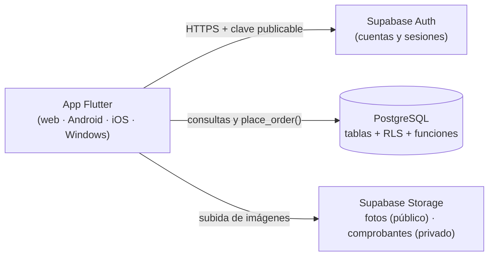

# WearUp — Plataforma E-Commerce de Moda

<p align="center">
  
</p>

<p align="center">
  <strong>Viste tu estilo</strong> — Aplicación multiplataforma (web, Android, iOS y Windows) desarrollada en Flutter para la venta de moda, calzado y accesorios, con compra guiada, pago por transferencia BRE-B con comprobante, seguimiento de pedidos y panel administrativo. El backend es <a href="https://supabase.com">Supabase</a> (PostgreSQL, autenticación y almacenamiento).
</p>

<p align="center">
  
  
  
  
  <a href="https://github.com/toroc07/wearup"></a>
</p>

---

## Tabla de Contenidos

1. [Descripción General](#descripción-general)
2. [Arquitectura](#arquitectura)
3. [Características Principales](#características-principales)
4. [Estructura del Proyecto](#estructura-del-proyecto)
5. [Modelo de Datos y Seguridad](#modelo-de-datos-y-seguridad)
6. [Roles y Acceso al Sistema](#roles-y-acceso-al-sistema)
7. [Instalación y Ejecución](#instalación-y-ejecución)
8. [Ejecución de Pruebas](#ejecución-de-pruebas)
9. [Identidad Visual](#identidad-visual)
10. [Repositorio](#repositorio)

---

## Descripción General

**WearUp** es la tienda en línea de una única empresa de moda. Los clientes consultan el catálogo (ropa, jeans, zapatos y accesorios), eligen talla y color, compran pagando por transferencia a una llave BRE-B y siguen el estado de sus pedidos. La empresa administra productos, inventario por talla y color, promociones y pedidos desde un panel administrativo.

---

## Arquitectura



* **Un solo código para todas las plataformas.** El cliente y el panel administrativo están en la misma app; el panel solo aparece para cuentas con rol de administrador.
* **La app no es de confianza.** Quién puede leer o modificar cada fila lo decide la base de datos con *Row Level Security* (RLS). Los pedidos solo se crean con la función `place_order()`, que valida el stock y calcula los precios en el servidor.
* **Estado en la app:** [`AppState`](lib/state.dart) (un `ChangeNotifier`) guarda la copia que se muestra del catálogo, el carrito, los pedidos y la sesión. Habla con el servidor a través de la interfaz [`Backend`](lib/backend.dart), cuya implementación real es [`SupabaseBackend`](lib/supabase_backend.dart). Las pruebas usan una implementación en memoria con las mismas reglas.

---

## Características Principales

### 1. Tienda
* **Inicio ([`HomeScreen`](lib/shop.dart)):** buscador, portada, accesos por categoría, productos destacados, banner de promoción configurable y enlace a la política de privacidad.
* **Catálogo ([`CatalogScreen`](lib/shop.dart)):** búsqueda por texto y filtros por **categoría**, **talla**, **color**, **precio** y **disponibilidad**. Se actualiza deslizando hacia abajo.
* **Selección de talla y color:** el botón *Agregar al carrito* abre un selector rápido; el detalle del producto ([`ProductDetailScreen`](lib/shop.dart)) muestra fotos, colores y tallas. Solo se pueden elegir combinaciones con stock; las agotadas aparecen tachadas.
* **Disponibilidad:** *Disponible*, *Últimas unidades* (5 o menos) o *Agotado*, y "Quedan N unidades" para la talla y color elegidos.

### 2. Compra en 5 pasos ([`CheckoutScreen`](lib/checkout.dart))
1. **Carrito:** cantidades limitadas al stock de cada talla y color; si el stock baja mientras el producto está en el carrito, se avisa y no se deja continuar.
2. **Envío:** nombre, teléfono (precargados desde el perfil), dirección, ciudad, departamento e indicaciones.
3. **Pago:** llave BRE-B de la tienda (configurada en la base de datos) con botón para copiarla.
4. **Comprobante:** foto o captura de la transferencia desde la galería o la cámara (JPG o PNG, máx. 10 MB). Se guarda en un espacio privado.
5. **Confirmación:** número de pedido y estado. El administrador valida el pago después.

### 3. Cuenta y seguimiento ([`account.dart`](lib/account.dart))
* **Registro** con nombre, teléfono, correo, contraseña y **autorización de tratamiento de datos** (Ley 1581 de 2012).
* **Inicio y cierre de sesión** reales; **recuperación de contraseña** con un código enviado al correo.
* **Mis datos:** editar nombre y teléfono, y **eliminar la cuenta**.
* **Mis pedidos:** filtro por *Todos*, *En curso* y *Entregados*.
* **Seguimiento:** línea de tiempo `Confirmado` ➔ `En preparación` ➔ `Enviado` ➔ `Entregado`, estado del pago (validado o en validación), dirección, productos y acceso al comprobante.
* **Política de privacidad** ([`legal.dart`](lib/legal.dart)).

### 4. Panel de administración ([`AdminScreen`](lib/admin.dart))
* **Panel:** productos activos, últimas unidades, agotados, pedidos por atender y pagos por validar.
* **Productos:** crear, editar y eliminar; definir colores y tallas (cada combinación es una variante con su SKU) y subir o quitar fotos.
* **Inventario:** stock de cada talla y color con botones + / − o escribiendo la cantidad.
* **Promociones:** mostrar u ocultar el banner del inicio y fijar el porcentaje anunciado (5 % a 70 %). *El porcentaje solo se muestra en el banner; no cambia los precios.*
* **Pedidos:** filtro por estado, datos del cliente, **ver el comprobante**, **validar el pago**, avanzar o fijar el estado y eliminar (si el pedido no se había entregado, las unidades vuelven al inventario).

---

## Estructura del Proyecto

```
wearup/
├── assets/                     # Logo y tipografía Montserrat
├── database/                   # Scripts SQL de Supabase e instrucciones
│   ├── 01_esquema.sql          # Tablas, relaciones, índices y disparadores
│   ├── 02_seguridad.sql        # RLS, funciones del servidor y almacenamiento
│   ├── 03_datos_prueba.sql     # Catálogo, variantes y pedidos de ejemplo
│   └── README.md               # Paso a paso para crear el proyecto Supabase
├── lib/
│   ├── main.dart               # Arranque: conexión con Supabase y navegación por pestañas
│   ├── config.dart             # URL y clave publicable del proyecto Supabase
│   ├── models.dart             # Producto, variante, pedido, perfil, configuración
│   ├── backend.dart            # Interfaz de operaciones con el servidor y mensajes de error
│   ├── supabase_backend.dart   # Implementación con Supabase
│   ├── state.dart              # AppState: catálogo, carrito, pedidos y sesión
│   ├── shop.dart               # Inicio, catálogo, selector de talla/color y detalle
│   ├── checkout.dart           # Compra en 5 pasos
│   ├── account.dart            # Ingreso, registro, mis datos, pedidos y seguimiento
│   ├── admin.dart              # Panel de administración
│   ├── legal.dart              # Política de privacidad
│   ├── widgets.dart            # Componentes compartidos
│   └── theme.dart              # Colores y tema de Material 3
├── test/
│   ├── fake_backend.dart       # Backend en memoria con las reglas del servidor
│   ├── state_test.dart         # Pruebas de la lógica (stock, pedidos, sesión, administración)
│   ├── widget_test.dart        # Pruebas de pantallas (compra, registro, filtros, panel)
│   └── live/                   # Prueba opcional contra el Supabase real
└── pubspec.yaml
```

---

## Modelo de Datos y Seguridad

El detalle de tablas y permisos está en [database/README.md](database/README.md). En resumen:

* **Stock por variante:** cada combinación talla + color es una fila de `product_variants` con su SKU y sus unidades.
* **Pedidos inmutables:** cada ítem del pedido guarda una copia del nombre, el precio, el color y la talla; editar o borrar el producto después no cambia el pedido.
* **Pedidos seguros:** `place_order()` bloquea las variantes, verifica el stock, toma los precios de la base, guarda el pedido y descuenta el inventario en una sola transacción.
* **Permisos (RLS):** el invitado solo ve el catálogo; el cliente ve y modifica solo lo suyo y no puede cambiar su rol; el administrador gestiona todo.
* **Comprobantes privados:** cada cliente sube a su propia carpeta del bucket `receipts`; solo él y el administrador pueden verlos, mediante enlaces temporales.
* **Datos personales:** la contraseña la guarda cifrada Supabase Auth; las comunicaciones van por HTTPS; el registro guarda la fecha de la autorización de datos; el usuario puede eliminar su cuenta.

---

## Roles y Acceso al Sistema

* **Cliente invitado:** explora el catálogo sin cuenta. Para comprar debe registrarse o ingresar.
* **Cliente:** se registra desde la pestaña *Cuenta* o al pagar. Compra, sigue sus pedidos y gestiona sus datos.
* **Administrador:** es una cuenta normal a la que se le asigna el rol desde la base de datos (ver [database/README.md](database/README.md), paso 9). Al ingresar, entra directo al panel; también lo encuentra en *Cuenta* → *Panel de administración*.

---

## Instalación y Ejecución

### Requisitos
* [Flutter SDK](https://docs.flutter.dev/get-started/install) `3.47` o superior (incluye Dart `3.13.3`).
* Navegador moderno, emulador o dispositivo Android/iOS, o Windows.
* Para compilar la versión de **Windows**: activar el *Modo de desarrollador* de Windows (Configuración → Sistema → Para programadores).

### Pasos
1. **Clonar el repositorio:**
   ```bash
   git clone https://github.com/toroc07/wearup.git
   cd wearup
   ```
2. **Instalar dependencias:**
   ```bash
   flutter pub get
   ```
3. **Ejecutar:**
   ```bash
   flutter run -d chrome      # Web
   flutter run -d android     # Android
   flutter run -d windows     # Windows
   ```

La app se conecta por defecto al proyecto Supabase de WearUp ([lib/config.dart](lib/config.dart)). La clave incluida es la **clave publicable**: es pública por diseño y solo permite lo que autorizan los permisos de la base de datos.

### Usar un proyecto Supabase propio
1. Crea el proyecto y ejecuta los scripts siguiendo [database/README.md](database/README.md).
2. Ejecuta la app indicando tu URL y tu clave publicable:
   ```bash
   flutter run --dart-define=SUPABASE_URL=https://xxxx.supabase.co --dart-define=SUPABASE_PUBLISHABLE_KEY=sb_publishable_xxxx
   ```

> Nunca pongas la clave secreta (`sb_secret_…`) en la app ni en el repositorio.

---

## Ejecución de Pruebas

```bash
flutter test
```

Las pruebas usan un backend en memoria que aplica las mismas reglas que la base de datos y validan:
* Stock por talla y color en el carrito y en el servidor.
* Compra completa: selección de talla y color, envío, comprobante, confirmación y seguimiento.
* Que un pedido no se cree si el stock bajó, y que editar un producto no cambie los pedidos anteriores.
* Registro con autorización de datos, inicio de sesión, recuperación de contraseña, edición y eliminación de la cuenta.
* Filtro por disponibilidad.
* Panel de administración: validar pagos, cambiar estados, eliminar pedidos devolviendo stock, crear y editar productos con sus variantes, y que un cliente no pueda hacer cambios de administrador.

Prueba opcional contra el Supabase real (crea una cuenta de prueba y la elimina al terminar; no crea pedidos):
```bash
flutter test test/live --dart-define=LIVE=true
```

---

## Identidad Visual

Material 3 con la tipografía **Montserrat** y la paleta de [lib/theme.dart](lib/theme.dart): azul `#1F6BB5`, azul marino `#12203A`, fondo `#F5F8FC`, bordes `#D5DEEA`, texto secundario `#5B6B80`, verde `#0F7B3F`, ámbar `#B45309`, rojo `#C62828` y turquesa `#4FB0CC`. El diseño se adapta a móviles y a pantallas anchas (≥ 800 px), donde el panel administrativo muestra un menú lateral fijo.

---

## Repositorio

* **GitHub:** [https://github.com/toroc07/wearup](https://github.com/toroc07/wearup)
* **ID de aplicación:** `com.wearup.wearup`
