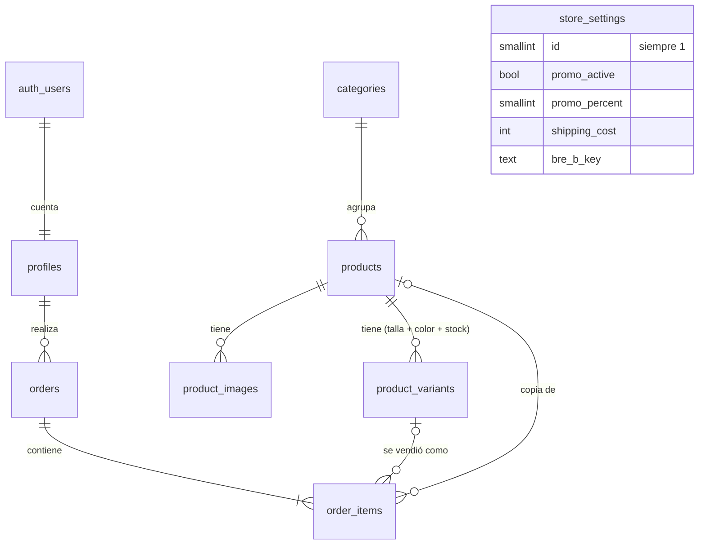

# Base de datos de WearUp (Supabase)

WearUp usa [Supabase](https://supabase.com) como backend: base de datos PostgreSQL, autenticación, permisos por fila (RLS) y almacenamiento de archivos. Todo funciona en el **plan gratuito** y en **modo de pruebas** (no se procesan pagos reales).

## Scripts

| Archivo | Contenido |
| :--- | :--- |
| [01_esquema.sql](01_esquema.sql) | Tipos, tablas, relaciones, índices y disparadores (incluye la creación automática del perfil al registrarse). |
| [02_seguridad.sql](02_seguridad.sql) | Permisos por fila (RLS), funciones del servidor (`place_order`, `delete_order`, `delete_my_account`, `is_admin`) y buckets de almacenamiento. |
| [03_datos_prueba.sql](03_datos_prueba.sql) | Configuración de la tienda, categorías, 5 productos con 54 variantes (talla + color + stock) y 2 pedidos de ejemplo. |

### Modelo de datos



* **Stock por variante:** cada combinación talla + color tiene su SKU y sus unidades (`product_variants`).
* **Pedidos inmutables:** `order_items` guarda una copia del nombre, el precio, el color y la talla al momento de comprar.
* **Pedidos seguros:** la app no inserta pedidos directamente; llama a `place_order()`, que verifica el stock, calcula los totales con los precios de la base y descuenta el inventario en una sola transacción.
* **Comprobantes privados:** las capturas de pago van al bucket privado `receipts`, en la carpeta de cada cliente; solo las ven el cliente y el administrador.

## Paso a paso: crear el proyecto en Supabase

1. **Crear la cuenta.** Entra a [supabase.com](https://supabase.com), pulsa **Start your project** e inicia sesión (por ejemplo, con GitHub).
2. **Crear la organización.** Si lo pide, crea una organización (por ejemplo `WearUp`) con el plan **Free**.
3. **Crear el proyecto.** Pulsa **New project** y completa:
   * **Name:** `wearup`
   * **Database Password:** pulsa *Generate a password* y guárdala en un gestor de contraseñas. No la subas al repositorio ni la compartas por chat.
   * **Region:** `East US (North Virginia)` (la más cercana a Colombia).
   * Deja las demás opciones como vienen y pulsa **Create new project**. Tarda uno o dos minutos.
4. **Ejecutar los scripts.** En el menú lateral abre **SQL Editor** → **New query**. Copia todo el contenido de `01_esquema.sql`, pégalo y pulsa **Run**. Repite con `02_seguridad.sql` y luego con `03_datos_prueba.sql`, **en ese orden**. Cada uno debe terminar con *Success*.
5. **Comprobar.** En **Table Editor** deben aparecer las tablas `products` (5 filas), `product_variants` (54 filas) y `orders` (2 filas). En **Storage** deben aparecer los buckets `product-images` y `receipts`.
6. **Configurar el registro.** En **Authentication** → **Sign In / Providers**:
   * **Allow new users to sign up** debe quedar **activado** (si se apaga, nadie puede crear cuenta).
   * En el proveedor **Email**: debe estar **habilitado** y con **Confirm email** **desactivado** mientras se desarrolla y se prueba. El servicio de correo incluido en el plan gratuito envía muy pocos correos por hora, y con la confirmación activa los registros de prueba se bloquearían.
7. **Plantilla de recuperación de contraseña.** La app recupera la contraseña con un **código** que llega al correo. En **Authentication** → **Emails** → **Templates** → **Reset Password**, reemplaza el cuerpo por:

   ```html
   <h2>Recupera tu contraseña de WearUp</h2>
   <p>Escribe este código en la app para crear una nueva contraseña:</p>
   <p style="font-size:24px;font-weight:bold;letter-spacing:4px">{{ .Token }}</p>
   <p>Si no lo pediste, ignora este correo.</p>
   ```

   > Con el servicio de correo incluido en el plan gratuito, Supabase **solo envía correos a las direcciones de los miembros del equipo** del proyecto (Organization → Team). Para enviar a cualquier cliente hay que configurar un SMTP propio en **Project Settings** → **Authentication** → **SMTP Settings**.
8. **Copiar las claves para la app.** Pulsa **Connect** (arriba en el panel) o ve a **Project Settings** → **API Keys** y copia:
   * **Project URL** (`https://<algo>.supabase.co`)
   * **Publishable key** (empieza por `sb_publishable_`). Es pública por diseño: va dentro de la app y la seguridad la dan los permisos RLS.

   > **Nunca** pongas en la app ni en el repositorio la **secret key** (`sb_secret_…`) ni la antigua `service_role`: saltan todos los permisos.
9. **Crear el administrador.** Regístrate en la app con el correo del administrador (o en **Authentication** → **Users** → **Add user**, marcando *Auto Confirm User*). Luego, en el **SQL Editor**, ejecuta cambiando el correo:

   ```sql
   update public.profiles set role = 'admin' where email = 'admin@wearup.com';
   ```

## Avisos del plan gratuito

* Un proyecto gratuito **se pausa tras una semana sin actividad**. Si pasa, entra al panel y pulsa **Restore project**. Conviene revisarlo antes de que el docente pruebe la app.
* Los pedidos de ejemplo no tienen cliente asociado: solo los ve el administrador.
